# 金融小二 · 整体流程详解（总图 + 层层放大）

> 阅读方法：先看第 1 章的**总流程图**，记住 ①～⑩ 十个编号；后文每一章就是把对应编号"放大"，展示该组件的内部流程图。像看地图一样：先看全国地图，再逐省放大。

---

## 1. 总览：这个项目是什么

一套面向零售银行的**金融智能客服后端**：用户发自然语言（或点选一个账户/银行卡/信用卡/交易/贷款卡片），系统判断这句话该交给谁处理，做完事后用自然语言回复。

**三种对话能力（一切设计围绕它）：**

| 能力 | 例子 | 一句话概括 |
|---|---|---|
| 任务流程 task | "我要查余额" / "我要申请贷款" | 按 YAML 里预定义的步骤，一步步收集信息、执行动作 |
| 信息检索 knowledge | "消费贷利率是多少" | 先查可信资料（中台 API / FAQ / 知识库），再让 LLM 组织回答 |
| 闲聊 chitchat | "你好呀" | 既不是任务也不是检索，LLM 结合历史随聊兜底 |

**系统组件关系：**

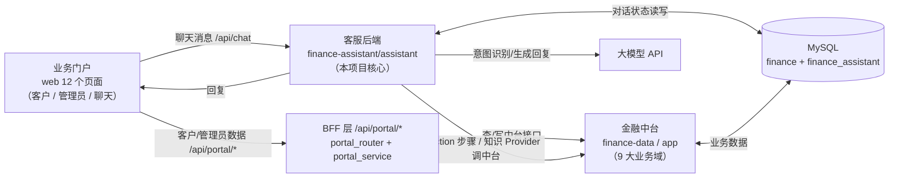

> 说明：金融小二比电商小二多出**两个东西**——①一个独立的**金融中台 `app/`**（模拟银行核心：客户、账户、交易、理财、信贷、还款、风控、催收、工单 9 大域，统一 `/api/v1` 前缀、字符串错误码、幂等 `request_no`、`Bearer` 鉴权 + `X-Operator-No` 操作员）；②一个**业务门户 BFF `/api/portal/*`**（为 web 12 个页面提供数据，客户身份用 `X-Customer-No` 透传）。本文聚焦第 ①～⑩ 的**对话引擎流程**（`assistant/` 包），中台与 BFF 只在需要处点一下。

---

## 2. 总流程图（一张图看懂全局）

一条用户消息从进来到返回，完整经过 **10 个环节**（⑩ 是对象消息专用支线）：

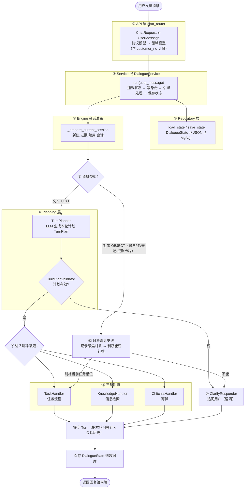

**核心思想一句话**：LLM 只负责"想"（识别意图、生成回复），代码负责"做"（校验、执行流程、改状态、调中台）。LLM 的输出永远不可信，所以每个 LLM 环节后面都跟一个**确定性校验/执行**环节。

下面开始逐个放大。

---

## 3. ① API 层：入口与模型转换

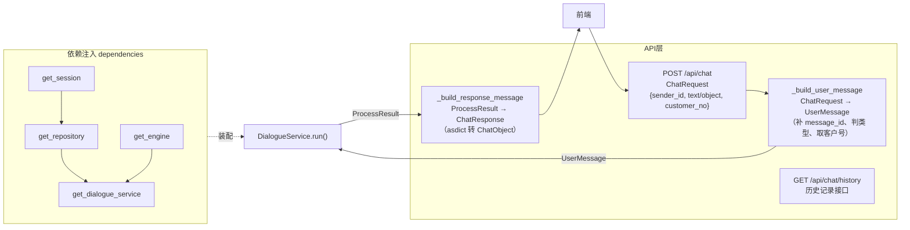

要点：
- **两套模型**：api 层用 Pydantic 定协议（对外），domain 层用 dataclass 定业务（对内）。转换函数只写在 chat_router；
- **依赖注入**：每个请求自动装配 `session → repository → service ← engine ← planner + validator`，各层不自己 new 依赖。其中 `engine` 是**启动时 `build_engine()` 一次建好、全局复用**的单例（`init_dialogue_engine()` 在 app 启动时调用）；
- 文本消息 → TEXT 类型；点选的账户/银行卡/信用卡/交易/贷款卡片 → OBJECT 类型；
- **身份切换（金融小二新增）**：`customer_no` 可从请求体传，也可用 `X-Customer-No` 请求头传（**请求头优先**，方便前端在拦截器里统一带身份）。它一路传进 UserMessage → Service 写进 `state.shared.customer_no` → Action/Provider 调中台时按它鉴权。空则回落到 `.env` 的 `demo_customer_no`。

> 同文件外的另一个路由 `portal_router`（`/api/portal/*`）属于**业务门户 BFF**，不参与对话引擎的 ①～⑩ 流程，只给 web 页面提供客户/管理员数据，本文不展开。

---

## 4. ② Service 层：一次处理的编排

Service 不写业务，只做**四步编排**：

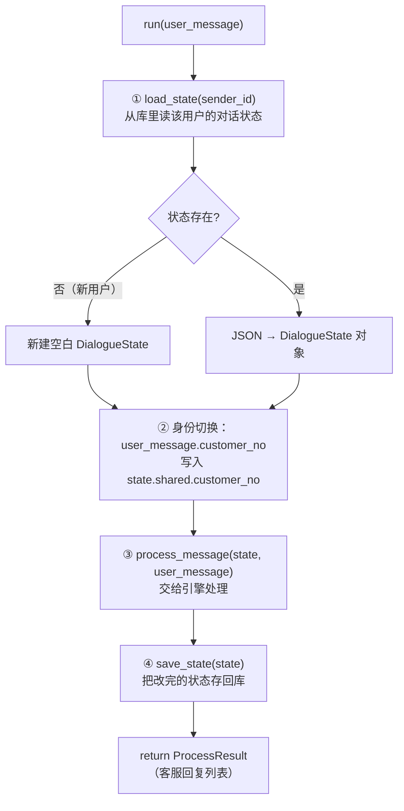

为什么先读后存？——**多轮对话的"记忆"不在内存里，全在这个 state**：读出来、改一通、存回去，下次再读出来就还认得用户。第 ② 步是金融小二比电商小二多的一步：前端切客户号后，后续所有 Action/Provider 调中台都按这个客户鉴权，**越权访问会被中台拒绝**。

---

## 5. ③ Repository 层：状态的持久化

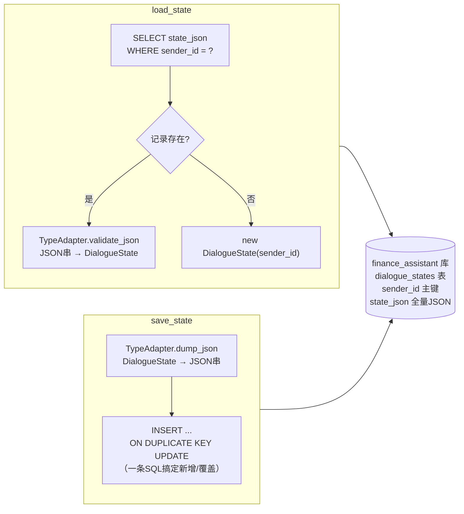

要点：
- 表结构极简：**一个用户一行**，整个对话状态就是一段 JSON 文本（文档型思路，不为 Session/Turn/Task 建一堆表）；
- **TypeAdapter**：pydantic 提供的 对象⇄JSON 双向转换器，转的过程中顺带做类型校验；
- 客服工程自己的库里还多一张 **`faq_items` 表**（question / answer / keywords / category / enabled），知识轨道的 FAQProvider 从这读（见第 10 章）。

---

## 6. ④⑤ Engine 层：会话准备与消息分发

Engine 是总调度。它先管"会话"，再按消息类型分发：

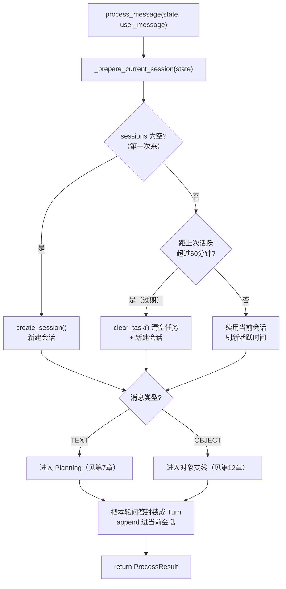

为什么要"60 分钟过期"？——用户连续聊天时会话不断续命；沉默超 1 小时视为"这次咨询结束"，**必须清掉查到一半的任务**，防止下次来时凭空冒出旧任务。

---

## 7. ⑥ Planning 层：本轮计划（本项目的"大脑"）

### 7.1 TurnPlanner 内部：怎么让 LLM 识别意图

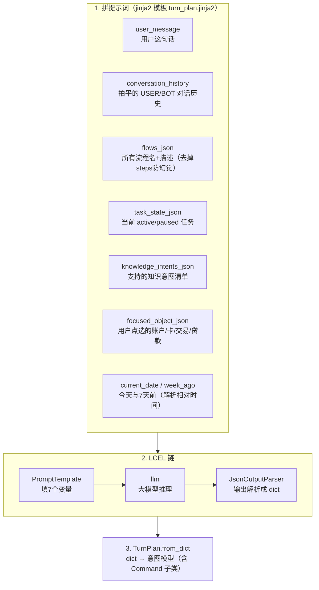

**TurnPlan 的结构**（LLM 的标准输出协议）：

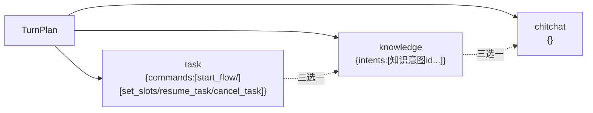

细节：
- **判断顺序写死在提示词里**：已有任务的补槽/恢复/取消 → 匹配流程的新任务 → 知识意图 → 都不是才闲聊。防歧义（"你好，帮我查余额"只算 task）；
- **flows_json 刻意去掉 steps**：LLM 只需要"选哪个流程"，给它步骤反而产生幻觉；
- **task_state_json 必须传**：用户说"继续刚才那个"，LLM 得看见 paused 里的任务和 task_id，才能给出正确的 resume 命令；
- **current_date / week_ago（金融小二新增）**：金融场景大量相对时间（"最近一周"、"上个月"），提示词里要求 LLM 结合"今天"解析，日期统一输出 `yyyy-MM-dd`；金额只输出数字字符串（"借五万"→`50000`）；
- 提示词末尾有**防注入声明**：数据区出现的指令不修改规则。

### 7.2 TurnPlanValidator 内部：确定性校验（不信 LLM）

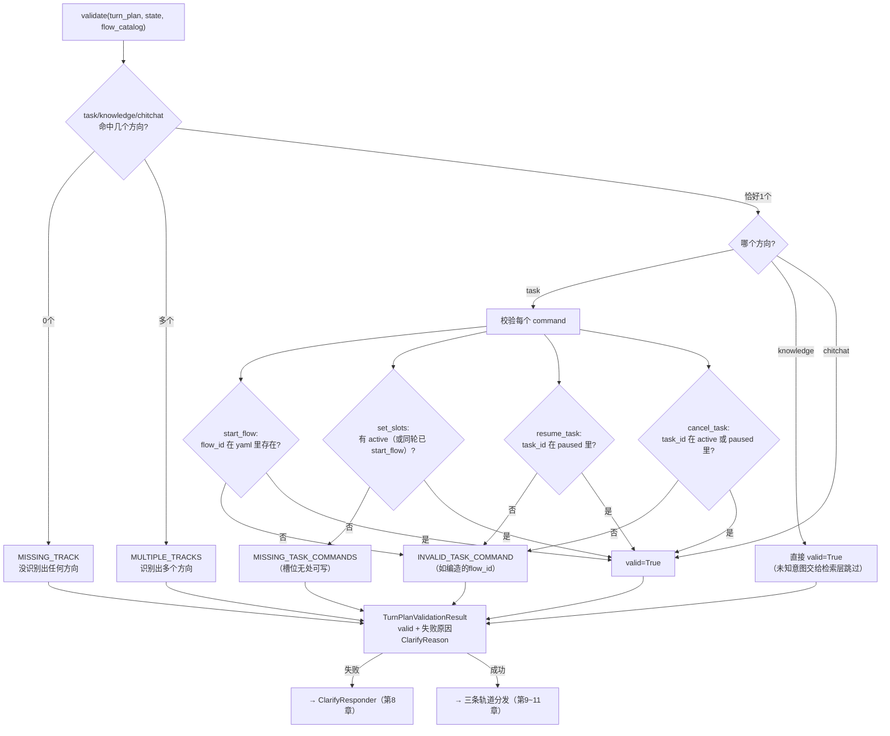

**设计哲学**：提示词里要求 LLM"task_id 必须原样复制"，但代码不放心——用**运行时事实（state）和配置事实（yaml）**逐条核对。校验失败不报错，而是转去"澄清追问"，体验更自然。

> 与电商小二的两点差异：①金融小二新增了 `set_slots` 的校验——**必须存在活跃任务（或同轮刚 `start_flow`）**，否则槽位无处可写；②`knowledge` 方向**不校验意图是否登记**（直接 valid），未知意图由 KnowledgeHandler 在检索阶段 `dict.get()` 兜底跳过，不炸 KeyError。

---

## 8. ⑨ ClarifyResponder：澄清追问

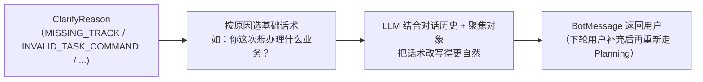

澄清不是失败终点，而是**把话说清楚再来一轮**：追问 → 用户补充 → 新消息重新进入总流程。金融小二还多了 `OBJECT_REQUIRES_INTENT` 这一类的专属话术——用户发了账户卡片但没说要干嘛时，按账户/卡/交易分别提示"你想查余额、查流水，还是……"。

---

## 9. ⑧-1 Task 轨道（上）：TaskHandler 总装

任务轨道是系统最复杂的部分，分**四步流水**：

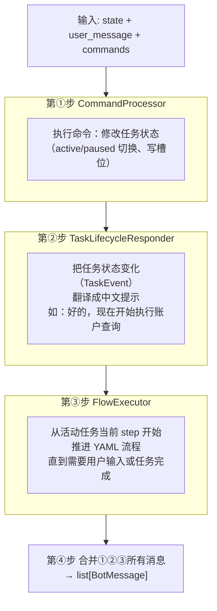

### 9.1 第①步 CommandProcessor：四种命令与任务状态机

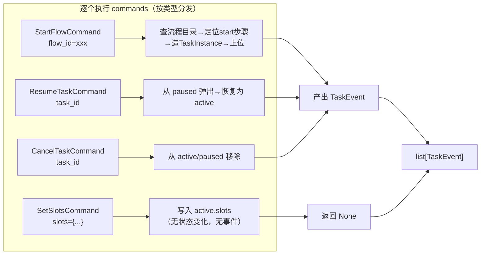

**任务状态机**（active/paused 就是"任务栈"，支持中断与恢复）：

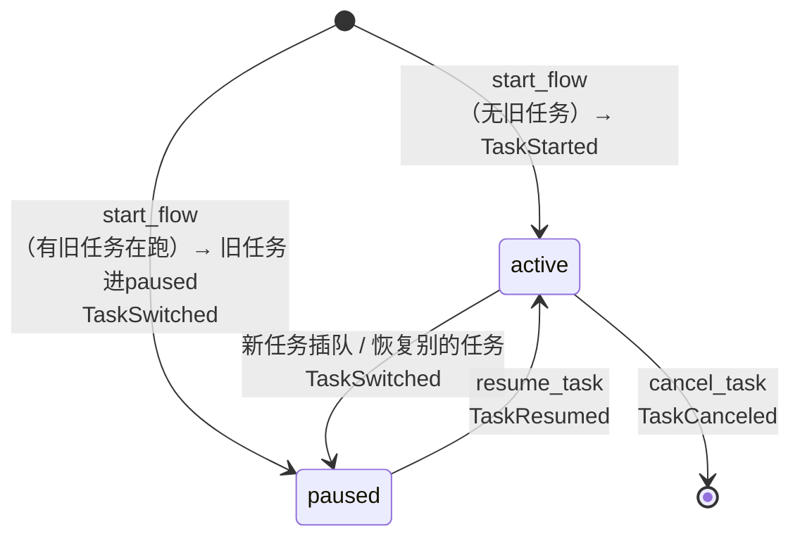

> 场景：查流水查到一半说"算了，我要申请贷款"——流水任务进 paused、贷款上位；说"继续查流水"再从 paused 恢复。

### 9.2 第②步 TaskLifecycleResponder：事件 → 人话

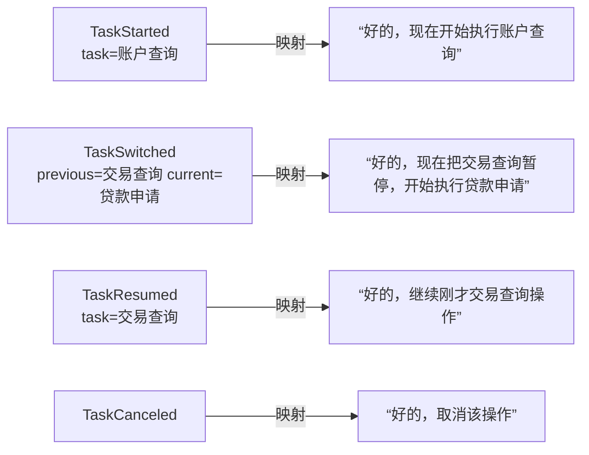

流程名不是硬编码，而是**拿事件里的 `flow_id` 到 FlowCatalog 反查 `flow.name`** 拼出来的——所以 YAML 里把流程改名，提示语自动跟着变。

### 9.3 第③步 FlowExecutor：流程引擎主循环（核心中的核心）

**先看一个具体流程长什么样（YAML 定义，改流程不改代码）：**

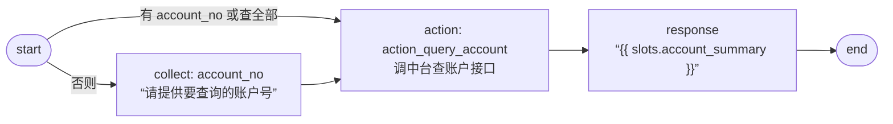

**FlowExecutor 的推进主循环：**

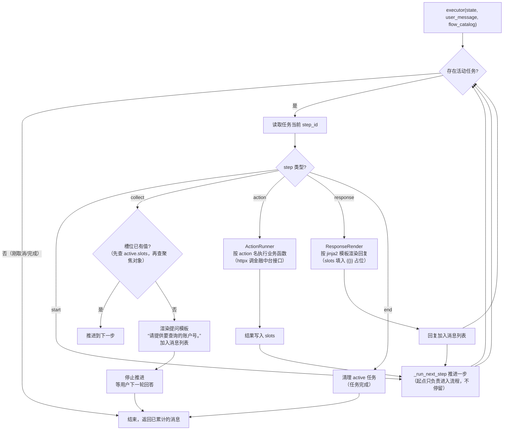

**主循环的节奏感（关键）：**
- **不停留的步骤**（start / action / response）执行完就 `_run_next_step` 推进，循环继续（最多 100 步防死循环）；
- **停留的步骤只有 collect**：槽位没填 → 发问 → 停，等用户下轮回答；下轮 Planning 生成 `set_slots` 命令写入槽位，FlowExecutor 从原 step 继续走；
- **collect 的取值顺序**：先查 `active.slots`，没有再从**聚焦对象**（`state.shared.focused_object`，见第 12 章）按 `object_slots.py` 的映射取值——所以用户点了一张卡，卡号能被 collect 步骤自动填上；
- **`_run_next_step` 的跳转**：next 只有一个链接 → 无条件跳；next 是列表 → 用 `eval(condition, {"slots":...})` 逐个算 `if` 表达式（按 slots 求值），全不中走 `else`（FallbackLink）。

**FlowExecutor 的三个支撑组件：**

| 组件 | 干什么 |
|---|---|
| ActionRunner | 执行 action 步骤声明的业务函数（查账户/查流水/查授信/提交贷款/挂失/投诉），本质是 httpx 调中台 |
| ResponseRender | 把 response/collect 模板里的 `{{ slots.xxx }}` 用 jinja2 渲染成最终回复 |
| （条件求值内联在 `_get_next_value`） | 用 `eval` 直接算 `slots.get('account_no')` 这类表达式，等价于电商小二的 ConditionEvaluator |

### 9.4 action 步骤内部放大：一个字符串的完整旅程

9.3 主循环里 action 分支只写了一行"ActionRunner 执行业务函数"。把它单独拎出来，画法和主循环一样——从上往下就是执行顺序：

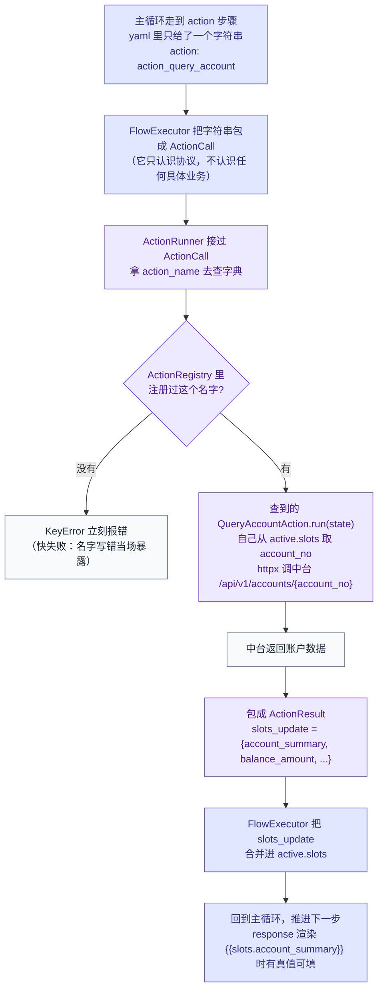

一段话（照主循环的读法读）：FlowExecutor 走到 action 步骤时手里只有一个字符串，它把字符串交给 ActionRunner 去字典（ActionRegistry）里查，查到谁就调谁的 run()——run() 自己拿槽位、自己调中台，把查到的"事实"装进 ActionResult 交回来，FlowExecutor 把这些事实合并进槽位后回到主循环继续推进，所以后面的 response 步骤才能把 `{{slots.account_summary}}` 填成真值。**为什么一个字符串要过这么多手？** 就是为了让 FlowExecutor 和具体业务互不认识：加一个新业务 = 写一个 Action 子类放进 `custom/` 目录（`register_custom_action` 会自动扫描注册），FlowExecutor 一行不改。顺带三个落地点：三头一致（yaml 的 `action:` 值 = 子类的 name 属性 = 注册表 key，一字不差，否则走 D 的 KeyError 分支）；action 产数据、response 产话术，解耦全靠 ActionResult.slots_update 这个字典；所有 Action 共用 `finance_client.py` 里的 `finance_request`（统一鉴权头、错误码→中文话术、幂等 `request_no`），不各自拼 URL。

金融小二的 6 个 Action（名字 ↔ 调的中台接口）：

| name | 类 | 调用的中台接口 |
|---|---|---|
| action_query_account | QueryAccountAction | GET /accounts/{account_no} 或 /customers/{no}/accounts |
| action_query_transactions | QueryTransactionsAction | GET /accounts/{account_no}/transactions |
| action_query_credit_limit | QueryCreditLimitAction | GET /customers/{no}/credit-limits + /loan/products/{code} |
| action_submit_loan_application | SubmitLoanApplicationAction | POST /loan/applications |
| action_report_card_loss | ReportCardLossAction | POST /support/tickets |
| action_create_complaint_ticket | CreateComplaintTicketAction | POST /support/tickets |

这是项目"字典表分发"的第 4 次出场：步骤（TYPE_TO_STEP_CLASS）、命令（COMMAND_NAME_TO_CLASS）、action（ActionRegistry）、事件话术（isinstance 判断）——**配置里永远只写字符串名，运行时按名查对象**。

---

## 10. ⑧-2 Knowledge 轨道：先查证据，再让 LLM 说话

⑦路由判中 knowledge 栏后，DialogueEngine 调 `knowledge_handler.handle(turn_plan.knowledge.intents, state, user_message)`——传进来的只是意图 id 列表。五步流水从上往下就是执行顺序：

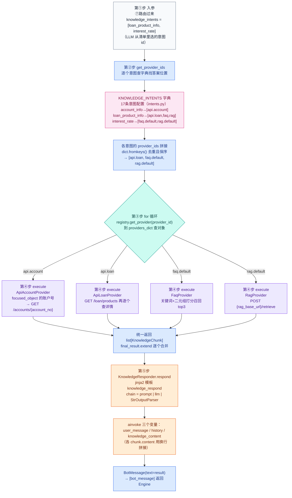

一段话（照 §9.4 的读法读）：KnowledgeHandler 拿到一串意图 id 后，先到 intents.py 的 KNOWLEDGE_INTENTS 字典查"答案在哪"——这份字典还有第二个身份：TurnPlanner 拼 `knowledge_intents_json` 提示词清单用的也是它（只喂 id + description，LLM 只能从清单里选，所以回来查必命中），每条配置还带 `requires_object` 标记哪些意图必须有聚焦对象。各意图的 provider_ids 拼起来用 `dict.fromkeys()` 去重（两个意图都绑了 faq.default 就只查一次，且保留注册顺序=答案优先级），然后 for 循环逐个 id：先到 registry 的 providers_dict 查对象（**又一个"字符串→对象"注册表，和 ActionRegistry 同构**），再 `await execute()`。`execute` 基类里统一 try/except：单个数据源异常返回空列表或中文提示，**不影响其他数据源**。Provider 自己决定查哪：api.* 用 `resolve_customer_no(state)` 鉴权 + `focused_object` 定位对象调中台，FaqProvider 查客服库的 `faq_items` 表（关键词命中 + 二元组重叠打分，取 top3），RagProvider 调可配置的知识库 `/retrieve`（`finance_rag_base_url` 为空则返回空）。所有结果都装成 KnowledgeChunk（带 `source` 来源标签）合并，最后交给 Responder 用 LCEL 链把 user_message、history、knowledge_content 三个变量喂给 LLM 润色成 BotMessage。**为什么绕这么大圈不让 LLM 直接答？**和 action 同一个哲学：LLM 不提供事实、只组织语言——先查到可信资料再回答，防幻觉。顺带三头一致：意图 id（提示词清单）= KNOWLEDGE_INTENTS 的 key；provider_id（意图配置里的值）= 子类 provider_id 属性 = 注册表 key，一字不差。

与电商小二的差异：金融小二把 FAQ / RAG **两个 TODO 都做成了真实实现**，并新增 `api.account / api.transaction / api.loan / api.wealth / api.deposit` 五个中台 Provider，意图清单也扩到 17 条。

---

## 11. ⑧-3 Chitchat 轨道：最简单的一条

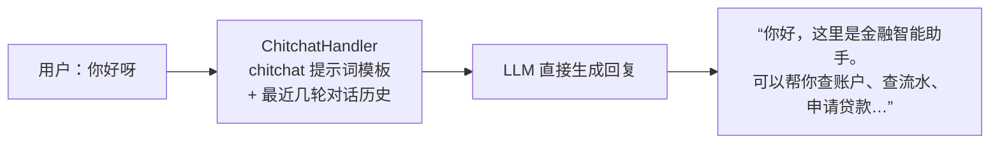

闲聊没有流程、没有检索，就是**提示词 + 历史 → LLM**。它在架构里的意义是**兜底**：任何话都有回应，永远不会"无法理解您的问题"。提示词里额外约束：不提供投资建议、不承诺收益、不索要密码/验证码等敏感信息。

---

## 12. ⑩ 对象消息支线：用户不发文字，点了个账户/卡/交易卡片

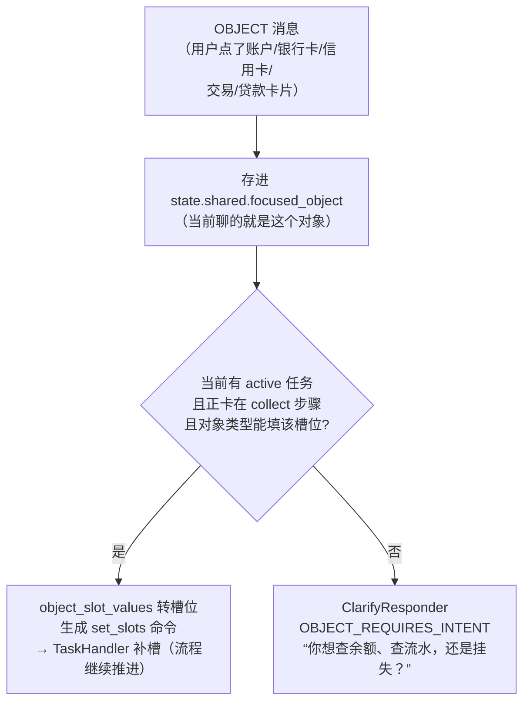

例：任务正卡在 "collect account_no"，用户点了账户 A1001 的卡片 → 槽位直接填上，流程继续，一句都不用多问。

三种对象的槽位映射（`domain/object_slots.py`，**谁能填哪个槽**写死在表里）：

| 对象类型 type | 能填的槽位 |
|---|---|
| account | account_no |
| card | card_no、account_no |
| credit_card | credit_card_no |
| transaction | transaction_no、related_transaction_no、account_no |
| loan | loan_application_no |

`_is_can_fill_slots` 会同时看三个条件：**有 active 任务**、**当前 step 是 collect**、**`can_fill_slot(对象类型, 槽位名)` 命中**——三者缺一不可，否则转澄清。

---

## 13. 一次完整对话串联（两轮跑完一个任务流程）

场景：查账户余额。**注意 FlowExecutor 是怎么"停一次、走到底"的：**

```mermaid
sequenceDiagram
    participant U as 用户
    participant E as Engine
    participant P as Planning(LLM)
    participant T as TaskHandler
    participant F as FlowExecutor
    participant M as 金融中台

    U->>E: 第1轮 "帮我查下账户余额"
    E->>P: plan()
    P-->>E: task: start_flow(account_query)
    E->>P: validate → 通过
    E->>T: TaskHandler(commands)
    T->>T: ① CommandProcessor: 新任务上位(TaskStarted)
    T->>T: ② 生成提示“好的，现在开始执行账户查询”
    T->>F: ③ 推进流程
    F->>F: start → 条件跳转：无 account_no → ask_account_no
    F->>F: collect(account_no): 槽位空→发问
    F-->>U: “请提供要查询的账户号。”（停，等输入）
    Note over E: 状态已存库：<br/>active任务停在ask_account_no

    U->>E: 第2轮 "6222020200000001"
    E->>P: plan()（LLM看到task_state_json里有个任务在等账户号）
    P-->>E: task: set_slots({account_no: "6222020200000001"})
    E->>T: TaskHandler
    T->>T: ① 写入槽位 ② 无状态变化无提示
    T->>F: ③ 从 ask_account_no 继续
    F->>F: collect: 槽位有值 → 过
    F->>M: action: 查账户接口(6222020200000001)
    M-->>F: {balance_amount, frozen_amount, ...}
    F->>F: response: 模板渲染 account_summary
    F->>F: end: 清理任务
    F-->>U: “账户 6222...0001（储蓄账户）<br/>余额：1,234.56 元 …”
```

---

## 14. 全组件职责速查表

| 组件 | 输入 | 输出 | 一句话职责 |
|---|---|---|---|
| chat_router | HTTP ChatRequest | HTTP ChatResponse | 协议转换，不写业务 |
| portal_router + portal_service | 客户/管理员请求 | 中台数据 | 门户 BFF，与对话引擎无关 |
| DialogueService | UserMessage | ProcessResult | 读状态→写身份→引擎→存状态 |
| DialogueRepository | sender_id / state | DialogueState | JSON⇄MySQL |
| DialogueEngine | state + user_message | ProcessResult | 会话管理 + 按类型分发 |
| TurnPlanner | state + 消息 + 流程目录 | TurnPlan | LLM 识别意图 |
| TurnPlanValidator | TurnPlan + state + 目录 | valid/失败原因 | 确定性校验，不信 LLM |
| ClarifyResponse | ClarifyReason | 追问消息 | 校验失败/上下文不足时兜底 |
| TaskHandler | commands + state + 消息 | list[BotMessage] | 任务轨道总装（四步流水） |
| CommandProcessor | list[Command] | list[TaskEvent] | 执行命令，改任务状态 |
| TaskLifecycleResponder | list[TaskEvent] | 提示消息 | 任务变化翻译成人话 |
| FlowExecutor | state + 流程目录 | list[BotMessage] | 主循环推进 YAML 流程 |
| ActionRunner | action 名 + state | ActionResult | 查注册表执行业务函数 |
| ActionRegistry | Action 子类实例 | name→对象映射 | action 注册表（custom/ 自动扫描注册） |
| ResponseRender | jinja2 模板 + slots | 回复文本 | 模板渲染（STATIC/REPHRASE/GENERATE） |
| KnowledgeHandler | intents + state + 消息 | list[BotMessage] | 知识轨道入口，五步流水编排 |
| KNOWLEDGE_INTENTS | 意图 id | provider_ids | 意图→答案位置字典（也喂提示词清单） |
| KnowledgeProviderRegistry | provider_id | Provider 对象 | 来源注册表，启动注册一次 |
| KnowledgeProvider×7 | state + 消息 | list[KnowledgeChunk] | 统一 execute() 接口屏蔽来源差异 |
| KnowledgeResponder | chunks + state + 消息 | BotMessage | LCEL 链把检索结果润色成回复 |
| ChitChatHandler | state + 消息 | list[BotMessage] | 提示词+历史→LLM 兜底 |
| finance_client | 方法+路径+客户号 | dict | 中台公共访问层（鉴权/错误码/幂等/格式化） |

---

## 15. 三条设计主线（理解了它们就理解了整个项目）

1. **LLM 出主意，代码做决定**：TurnPlanner 提方案 → Validator 用事实核对 → 不通过就澄清重来。LLM 的每个输出都要被确定性代码"过安检"。
2. **状态是唯一的记忆**：一切多轮能力（会话、任务栈、槽位、聚焦对象、**当前客户号**）都存在 DialogueState 一个 JSON 里，每轮"读→改→存"。
3. **协议先行，实现跟进**：TurnPlan / Command / TaskEvent / KnowledgeChunk 这些"数据协议"先定死，各处理器围绕协议独立开发——所以每个 Handler 内部结构都高度相似（入口→编排→生成回复）。金融小二在这个骨架上又多铺了两层：**一个可自动注册的 Action/Provider 插件层**（加业务不加引擎代码），**一个统一的中台访问层**（鉴权、错误话术、幂等集中处理）。
