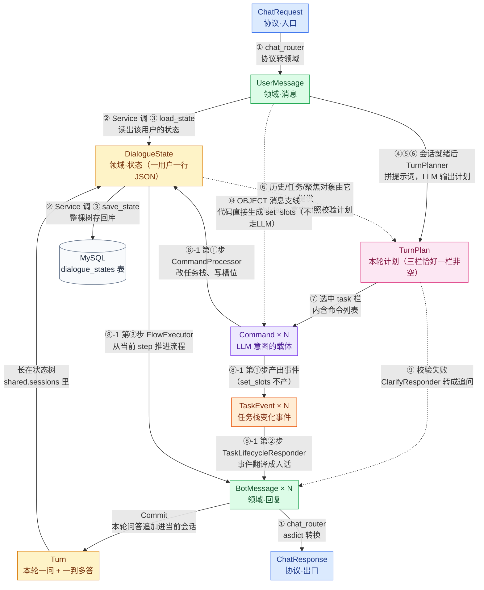
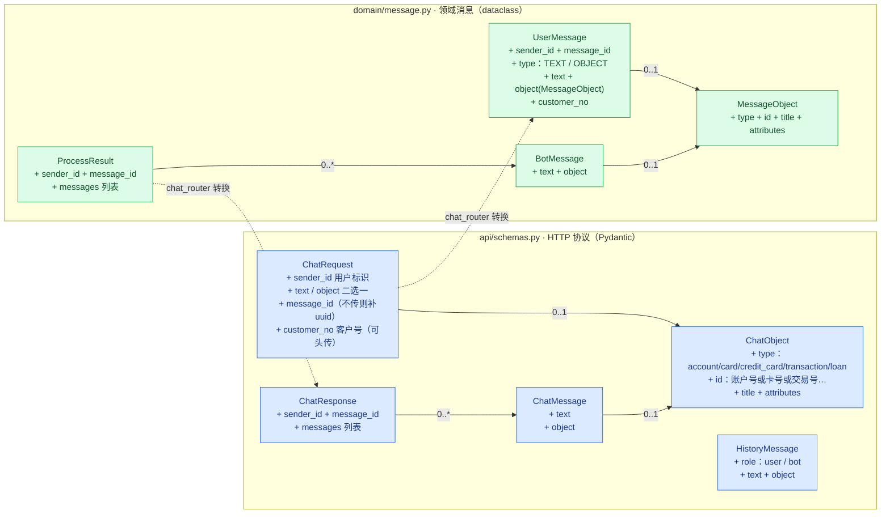
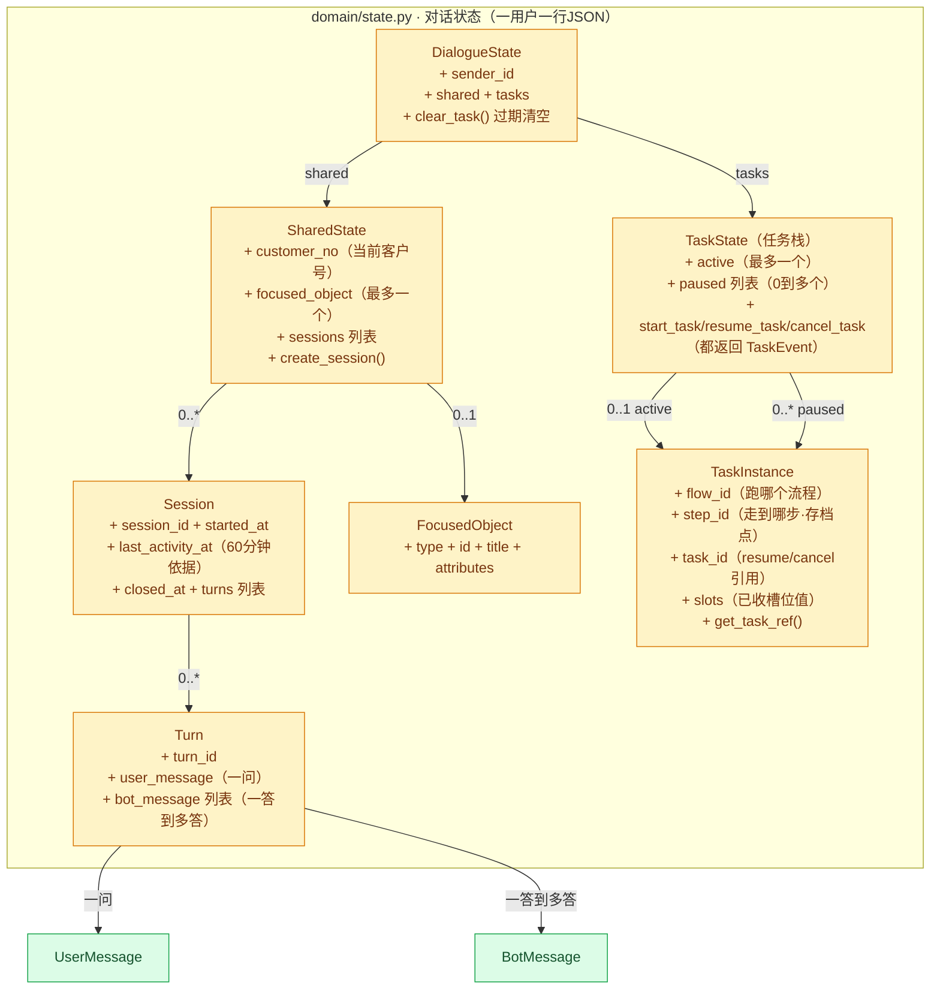
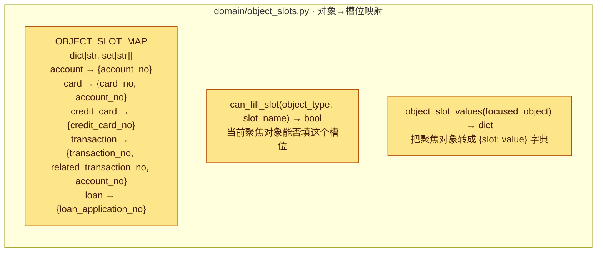
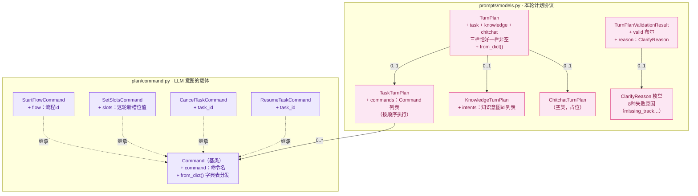
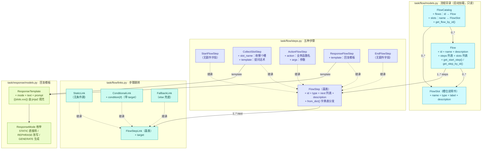
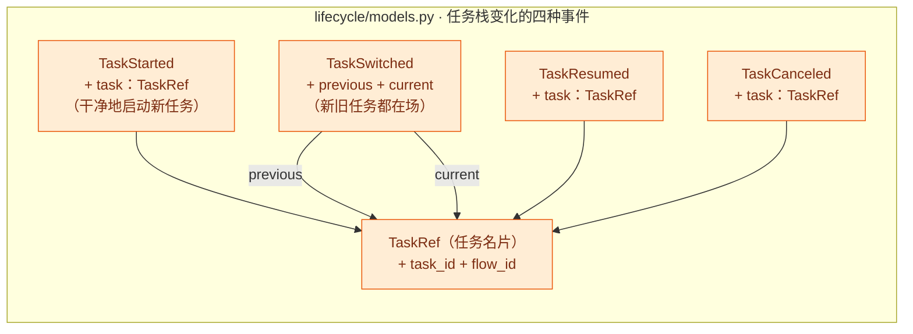
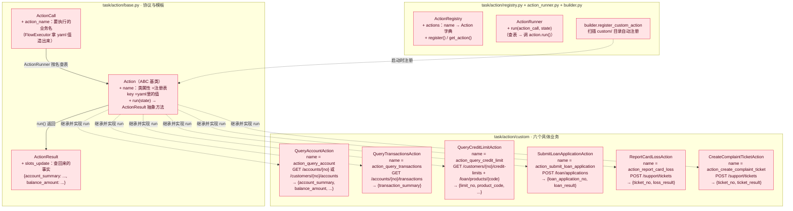
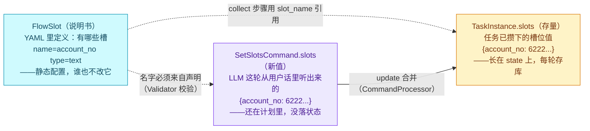
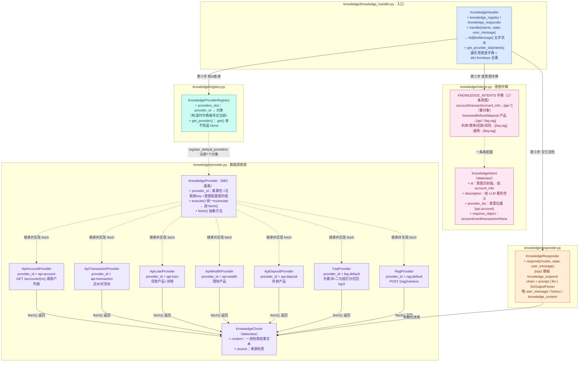

# 金融小二 · 模型类图详解（按总流程顺序看懂所有类和字段）

> 阅读方法：对照《金融小二-整体流程详解.md》的 ①～⑩ 编号。消息每流到一个环节，身上带的对象就换一批——本文按流程顺序逐个展示这些类，**每个类的每个字段是什么、谁创建它、谁消费它**。所有字段均与老师代码一一对应。
>
> **画法说明**：类图全部用 flowchart + classDef 绘制（和课件同款），**同一种颜色 = 同一个 py 文件**。classDiagram 语法不支持 classDef 配色，所以弃用。

**颜色图例（记住这张表，全文通用）：**

| 颜色 | 文件 |
|---|---|
| 蓝 | api/schemas.py（HTTP 协议模型） |
| 绿 | domain/message.py（领域消息模型） |
| 黄 | domain/state.py（对话状态树） |
| 棕 | domain/object_slots.py（对象→槽位映射） |
| 紫 | plan/command.py（LLM 意图载体） |
| 粉 | prompts/models.py（本轮计划协议） |
| 橙 | lifecycle/models.py（任务变化事件） |
| 青 | task/flow/models.py（流程目录） |
| 靛 | task/flow/steps.py（五种步骤） |
| 蓝绿 | task/flow/links.py（步骤跳转） |
| 黄绿 | task/response/models.py（回复模板） |
| 玫红 | task/action 包（业务动作：远程调中台） |
| 灰 | utils/finance_client.py（中台公共访问层） |

---

## 0. 总览：一条消息带着哪些对象走完全程

先把"对象交接"的全景画出来，后面每章放大其中一段（每种颜色一个文件）：

**怎么看这张图（三条线索）：**

1. **主干（实线）**：一条消息走完全程的顺序——① 进来转成 UserMessage → ②③ 读出状态 → ④⑤⑥ 出计划 → ⑦ 选中 task 栏 → ⑧-1 Task 轨道内部三步产生回复 → Commit 成 Turn 记进状态 → ②③ 存回库 → ① 转成 ChatResponse 出去（⑧-2 Knowledge、⑧-3 Chitchat 两条轨道本图未画）；
2. **两条虚线旁路**：⑨ 校验失败转追问、⑩ 对象消息直接补槽——虚线都是"不经过 LLM 的捷径"；
3. **黄色节点被指最多**：DialogueState（状态树）和 Turn 是唯二"活过这一轮"的东西——状态树被读、被改、被存，Turn 追加进它；其余对象（TurnPlan、Command、TaskEvent）全是一轮内的临时工，用完即弃。

**⑦ 路由说明**：⑦ 在总流程图里是独立菱形，但在这张对象图上它就是"`TP → CMD`"那条边——TurnPlan 三栏哪栏非空走哪条轨道，路由决策在 LLM 出计划那一刻就定了。图中画的是选中 task 栏（**⑧-1** Task 轨道）的情形；knowledge 栏走 **⑧-2**、chitchat 栏走 **⑧-3**。**编号约定：⑧-1/⑧-2/⑧-3 永远指三条轨道；TaskHandler 内部的四步用"第①～④步"表示，不再占用 ⑧-x。**

---

## 1. ① API 层的模型：成对出现的"两套模型"

项目里每个消息概念都有**两个类**：Pydantic 版（对外 HTTP 协议，`api/schemas.py`，蓝色）和 dataclass 版（对内领域模型，`domain/message.py`，绿色）。字段几乎一样，`chat_router` 里互转。

**字段逐个说：**

| 类 | 字段 | 含义 |
|---|---|---|
| ChatRequest | sender_id | 用户标识，数据库里"一个用户一行状态"的key |
| | text / object | 文本、卡片**二选一**（text 优先判类型） |
| | message_id | 前端可不传，后端补 uuid，响应里原样回传 |
| | customer_no | 客户号；请求体可传，也可用 `X-Customer-No` 头传（**头优先**） |
| ChatObject | type | 卡片种类：account（账户）/ card（银行卡）/ credit_card（信用卡）/ transaction（交易）/ loan（贷款） |
| | id | 账户号/卡号/交易号——后面一切"这个对象"的根源 |
| UserMessage | type | 枚举 TEXT / OBJECT，chat_router 里判断后写入 |
| UserMessage | customer_no | 前端切身份后传给 Service 写进 state |
| BotMessage | text / object | 客服回复可以是纯文本，也可以带卡片 |
| ProcessResult | messages | 一轮可能多条回复（任务提示 + 流程提问），所以是**列表** |

**交接点**：`ChatRequest → UserMessage`（`_build_user_message`，补 message_id、判 TEXT/OBJECT、取客户号）；`ProcessResult → ChatResponse`（`_build_response_message`，dataclass 用 `asdict()` 转成 dict 才能喂给 Pydantic）。

---

## 2. ②③ DialogueState 全家：整个项目的"记忆"（domain/state.py）

这是最重要的一章。**整个对话状态 = 一个用户一行 JSON**，所有类都长在 DialogueState 这棵树上，每轮被"读出来 → 改 → 存回去"。

**逐层拆解：**

- **DialogueState**：只有两个字段 `shared`（三种能力共享的数据）和 `tasks`（任务流程特有的数据）；
- **SharedState**：
  - `customer_no`：**当前会话登录的客户号**（金融小二新增）。前端切身份时由 Service 写入，Action/Provider 调中台时靠它鉴权，空则回落 `.env` 的 `demo_customer_no`；
  - `focused_object`：用户最近点选的账户/卡/交易/贷款（**最多一个**，新点选覆盖旧的）——⑩对象支线写入，知识轨道和 collect 步骤都查它；
  - `sessions`：所有历史会话的列表，**最后一个**是当前会话；
- **Session**：`last_activity_at` 是 60 分钟过期判断的依据；`turns` 是这个会话里的每一轮问答；
- **Turn**：一轮 = 一条 `user_message` + 一到多条 `bot_message`（一问多答）；
- **TaskState**：任务栈。`active` 最多一个，`paused` 0 到多个。三个方法 `start_task / resume_task / cancel_task` 分别对应三种命令，**都返回 TaskEvent**（见第 4.2 章）；
- **TaskInstance**：一个正在跑/暂停着的任务。字段各司其职：
  - `flow_id`：跑哪个流程（对应 YAML，如 account_query）；
  - `step_id`：**走到哪一步了**——FlowExecutor 的"存档点"，中断恢复全靠它；
  - `task_id`：任务唯一标识（uuid），LLM 生成 resume_task / cancel_task 命令时要**原样引用**它；
  - `slots`：这个任务**已收集到的槽位值**（第 5 章专讲）；
  - `get_task_ref()`：把自己缩成 `TaskRef` 名片（task_id + flow_id），事件只带名片不带全量数据。

**交接点**：Service 层每轮 `load_state` 从 JSON 还原它 → Engine 改它 → `save_state` 整棵树 dump 回 JSON 存库。

### 2.1 对象 → 槽位的映射（domain/object_slots.py，棕）

这是金融小二相对电商小二**新增的一个独立文件**：把"前端发来的业务对象能填哪些槽位"这张表，从对话引擎里抽出来单独维护。

- **OBJECT_SLOT_MAP**：`{对象类型: 能填的槽位集合}`。第 12 章对象支线的 `_is_can_fill_slots` 和 FlowExecutor 的 collect 步骤都靠它；
- **can_fill_slot**：`slot_name in OBJECT_SLOT_MAP.get(object_type, set())`——一句话判断"这个对象能不能补这个槽"；
- **object_slot_values**：把聚焦对象拆成槽位值字典（如 account 对象 → `{account_no: id}`；card 对象 → `{card_no: id, account_no: attributes.account_no}`）。

---

## 3. ⑥ Planning 层的模型：TurnPlan 与四种 Command（prompts/models.py + plan/command.py）

**逐个说：**

- **TurnPlan**：LLM 每轮输出的"工单"，三栏**恰好一栏非空**——哪个非空 Engine 就走哪条轨道；
- **TaskTurnPlan.commands**：命令**列表、按顺序执行**（"查账户 6222…" = [start_flow, set_slots] 两条）；
- **Command 基类与 from_dict 工厂**：LLM 输出的是普通 dict（`{"command": "start_flow", "flow": "xxx"}`），`COMMAND_NAME_TO_CLASS` 字典表把 command 字符串映射到子类，`from_dict` 据此造出对应对象——**和 FlowStep 用的是同一套"字典表分发"手法**；
- **四个子类的字段**：`flow`（流程 id，必须是 YAML 里存在的）、`slots`（这轮听出的槽位新值）、`task_id`×2（必须原样复制 state 里的）；
- **ClarifyReason**：校验失败的八种原因枚举（没方向 / 多方向 / 命令为空 / 意图为空 / 缺聚焦对象 / 对象缺意图 / 命令不合法 / 意图不存在），Validator 核对失败时给出，ClarifyResponder 按它选追问话术；
- **TurnPlanValidationResult**：校验结果 = valid 布尔 + 失败原因，**不抛异常**。

**交接点**：TurnPlanner 创建 TurnPlan（LLM JSON → `TurnPlan.from_dict`）→ Validator 校验出 Result → 合法则 TaskHandler 消费 commands。

---

## 4. ⑧-1 Task 轨道的模型：YAML 流程与事件（task/flow + task/response + lifecycle）

### 4.1 Flow 模型：流程目录（四个文件四种颜色）

**逐个说：**

- **FlowCatalog**：启动时 YAML 加载出的"流程目录"，全程只读。`flows`（流程 id → Flow）给三处用：TurnPlanner 拼 flows_json（**去掉 steps**，防 LLM 幻觉）、Validator 校验 flow_id、CommandProcessor 造新任务定位 start 步骤；`slots`（槽位名 → FlowSlot）是全局槽位说明书；
- **Flow**：一个业务流程。`steps` 是步骤链，`slots` 是这个流程声明要用哪些槽；两个方法 `get_start_step / get_step_by_id` 是"按图找节点"的查询器；
- **FlowSlot**：槽位的**定义**（name / type / label / description）——注意它和 TaskInstance.slots 的区别见第 5 章；
- **FlowStep + 五个子类**：`from_dict` 同样用 `TYPE_TO_STEP_CLASS` 字典表分发。基类字段 `id`（步骤名）、`type`、`next`（跳转链接列表）、`description`；子类各有增量字段：
  - StartFlowStep / EndFlowStep：无额外字段；
  - CollectSlotStep：`slot_name`（收哪个槽）+ `template`（提问话术）——FlowExecutor 靠 slot_name 去任务 slots 里查有没有值；
  - ActionFlowStep：`action`（业务函数名，ActionRunner 按名分发，见 4.3）+ `args`；
  - ResponseFlowStep：`template`（回复模板）；
- **三种 Link**：`next` 是字符串 → 包成 StaticLink（无条件跳）；是列表 → 每项带 `if/then` 的包成 ConditionalLink、带 `else` 的包成 FallbackLink——统一成"链接对象"后，FlowExecutor 的 `_run_next_step` 不用关心 next 原本是什么形状；
- **ResponseTemplate**：`mode` 三种——STATIC（直接用 text）、REPHRASE（LLM 把 text 改写）、GENERATE（LLM 按 prompt 生成）；`{{slots.xxx}}` 占位符由 ResponseRender 用 jinja2 填充。（注：`from_dict` 只回填 text/prompt，GENERATE 分支在 ResponseRender 里尚未实现。）

### 4.2 TaskEvent 模型：任务变化的事件（lifecycle/models.py）

- **TaskRef**：任务的"轻量名片"，只有 task_id + flow_id。TaskState 的方法不直接返回整个 TaskInstance，只返回名片——**事件只需要知道"是谁"，不需要背上全部槽位数据**；
- **四种事件**对应任务栈的四种变化；`TaskEvent` 是这四者的**联合类型**（TypeAlias）；
- **TaskSwitched 携带 previous 和 current 两个名片**——这是"先暂停交易查询，帮您办理贷款"这句话能把两个任务名都说出来的原因；
- **交接点**：TaskState 的方法产出事件 → CommandProcessor 收集成 list → TaskLifecycleResponder 翻译成人话。注意 set_slots **不产生事件**（任务栈没变化），所以补槽那轮没有"好的收到"这类提示。

### 4.3 Action 模型：一次远程调用的对象流水（task/action 包，玫红）

FlowExecutor 走到 action 步骤时，"yaml 里一个字符串（step.action）"变成"一次中台调用"，中间经过这些类：

- **两个 dataclass 是协议，Action 基类是模板**：ActionCall 进（要干嘛）、ActionResult 出（查到啥）；ABC 强迫每个业务子类实现 run，谁忘写谁启动就报错；
- **name 三头一致是唯一的接线**：yaml 里 `action: action_query_account` = 子类 name 类属性 = 注册表 key。查不到直接 KeyError——快失败比悄悄走错好；
- **slots_update 直接喂 slots**：FlowExecutor 拿到 ActionResult 后 `active.slots.update(slots_update)`——它是 5.1 章三个 slots 之外的**第四个字典**，同样 update 进 TaskInstance.slots；
- **注册器（金融小二已实现自动扫描）**：`register_custom_action` 用 `pkgutil.iter_modules` 扫描 `custom/` 目录下的 `.py` 文件，反射找出"定义在本模块"的 Action 子类并注册——**加新 Action 只需在 custom/ 下加文件，一行注册代码都不用改**（电商小二这里是老师留的 todo）。

**交接点**：FlowExecutor 造 ActionCall → ActionRunner 查表执行 → ActionResult 回来 → slots.update → 推进下一步，response 步骤渲染时就能用上这些"系统查回来、用户从没说过"的值。所有 Action 共用 `finance_client.py` 的 `finance_request`（见下表）做鉴权、错误映射和幂等。

**finance_client.py（灰，金融小二新增的公共访问层）：**

| 函数 | 职责 |
|---|---|
| finance_request(method, path, customer_no, ...) | 统一调中台：拼 `/api/v1` 前缀、带鉴权头、`code!=0` 抛 FinanceError |
| resolve_customer_no(state) | 取当前会话客户号，空则回落 `demo_customer_no` |
| money / to_decimal | 金额千分位格式化 / 转 Decimal |
| new_request_no(slots) | 写接口幂等号：首次生成后写回槽位，重试复用 |
| mask_no | 脱敏（卡号/证件号只留后四位） |
| normalize_date | 把槽位里的日期归一化成 yyyy-MM-dd |

---

## 5. 三个 slots 与对象消息映射：最容易混的地方

### 5.1 三个 slots 的关系

项目里有三个叫 slots 的东西，**身份完全不同**（颜色对应上面各章）：

一句话：**FlowSlot 定义"有哪些格子"，command.slots 是"这轮新填的值"，TaskInstance.slots 是"格子里已存的值"**。三者的键名必须一致（都叫 account_no），值只在 TaskInstance.slots 里流转。

时间线（查账户两轮对话）：

1. YAML 里先定义 FlowSlot `account_no`，流程里 collect 步骤声明 `slot_name: account_no`；
2. 第 1 轮：start_flow 造出 TaskInstance，此时它的 `slots = {}`（空）；
3. 第 2 轮用户答"6222020200000001"：LLM 输出 `SetSlotsCommand(slots={"account_no": "6222020200000001"})`；
4. CommandProcessor 执行 `active.slots.update(command.slots)` → TaskInstance.slots 变成 `{account_no: 6222...}`；
5. FlowExecutor 走到 collect 步骤，查 TaskInstance.slots 里有值了 → 不再提问，继续推进；
6. 同一轮后半段走到 action 步骤：ActionResult.slots_update（中台查回的 account_summary、balance_amount 等"事实"）同样 update 进 TaskInstance.slots——用户从没"说"过余额，但 response 模板渲染得出来，数据就是这来的（见 4.3）。

### 5.2 对象消息与槽位的映射（三个 object + 一张表）

`ChatObject`、`MessageObject`、`FocusedObject` 三个类**字段几乎一模一样**（type/id/title/attributes），但位置和身份不同：

| 类 | 在哪 | 身份 |
|---|---|---|
| ChatObject | api/schemas.py（蓝） | **HTTP 协议**上的卡片，只存在于请求/响应的 JSON 里 |
| MessageObject | domain/message.py（绿） | **领域消息**里的卡片，UserMessage.object / BotMessage.object |
| FocusedObject | domain/state.py（黄） | **状态里记住的**"当前聊的是哪个对象"，比前两者活得久 |

流转关系：前端发来的 ChatObject → chat_router 转成 MessageObject（挂在 UserMessage 上）→ 对象支线把它转成 FocusedObject 存进 state.shared → 从此一直活着（知识轨道查 API、TurnPlanner 拼 focused_object_json、FlowExecutor 的 collect 补槽都用它），直到被新点选覆盖或会话过期清空。

**对象 → 槽位这张表**（`domain/object_slots.py`）才是金融小二补槽的关键：它规定了 **account/card/credit_card/transaction/loan 五类对象各自能填哪几个槽位**，`can_fill_slot` 和 `object_slot_values` 两个函数把它变成可直接执行的判断与取值。

---

## 6. ⑧-2 Knowledge 轨道的模型：意图字典 + Provider 家族（knowledge 包）

和 4.3 的 action 家族完全同构——**ABC 基类 + id 类属性 + 注册表字典 + 字符串接线**，只是这次分发的不是"业务函数"而是"知识来源"。⑦路由判中 knowledge 栏后，Engine 调 `KnowledgeHandler.handle(intents, state, user_message)`，下面这些类依次登场（同一个 py 文件同一种颜色）：

- **一份字典两个身份**：KNOWLEDGE_INTENTS 既是 Handler 查"答案在哪"的表，也是 TurnPlanner 拼 `knowledge_intents_json` 提示词清单的来源（只喂 id + description）——LLM 只能从清单里选 id，回来查必命中，和 flows_json 是同一个"LLM 只能点菜、不能造菜"的手法；
- **与 action 家族逐一同构**：Action(ABC) ↔ KnowledgeProvider(ABC)、name ↔ provider_id、ActionRegistry ↔ KnowledgeProviderRegistry、ActionRunner 查表 ↔ get_provider 查表。区别只在出口：action 返回 ActionResult.slots_update **喂槽位**（模板渲染），provider 返回 KnowledgeChunk **喂 LLM**（润色成自然语言）；
- **provider_id 三头一致**：意图配置里的值 = 子类 provider_id 属性 = 注册表 key。但 get_provider 用 `.get()`，查不到返回 None 而不是 KeyError——和 ActionRegistry 的快失败风格不同，None 会晚一步在 execute 才炸，算个小坑；
- **execute 统一兜底**：基类 `execute` 包一层 try/except，`FinanceError` 转成中文提示 chunk、其他异常返回空列表——**单个数据源挂掉不影响别的数据源**，这是金融小二对电商小二 base 的直接增强；
- **requires_object 标记**：account_info / transaction_info / card_info 标了 account/transaction/card，意思是查这类信息必须有聚焦对象（⑩对象支线写入 state.shared 的那个）——"说要查账户却没点账户"的场景靠它识别；
- **七个 Provider（无 TODO）**：电商小二留空的 FAQ/RAG 在这里都做成了真实实现——FaqProvider 查客服库 `faq_items` 表（关键词命中×2 + 二元组重叠×0.5 打分取 top3），RagProvider 调 `finance_rag_base_url` 的 `/retrieve`（未配置则返回空）。

**交接点**：Engine 调 handle → 五步流水（意图列表 → 查意图字典去重 → 查注册表 → 逐个 execute 收集 chunks → Responder 润色）→ list[BotMessage] 回 Engine → Commit 成 Turn。对应整体流程详解的 §10。

---

## 7. 全模型速查表（文件 → 类 → 一句话职责）

| 文件 | 图上颜色 | 类 | 对应环节 | 一句话 |
|---|---|---|---|---|
| api/schemas.py | 蓝 | ChatRequest / ChatObject / ChatMessage / ChatResponse / HistoryMessage / HistoryResponse | ① | HTTP 协议模型（Pydantic），含 customer_no |
| domain/message.py | 绿 | UserMessage / BotMessage / MessageObject / MessageType / ProcessResult | ①② | 领域消息模型（dataclass），含 customer_no |
| domain/state.py | 黄 | DialogueState / SharedState / Session / Turn / FocusedObject | ②③④ | 对话状态树（一用户一行 JSON） |
| domain/state.py | 黄 | TaskState / TaskInstance | ⑧-1 | 任务栈与任务实例（存档点+槽位） |
| domain/object_slots.py | 棕 | OBJECT_SLOT_MAP / can_fill_slot / object_slot_values | ⑩+⑧-1 | 对象→槽位映射表，对象消息补槽的依据 |
| plan/command.py | 紫 | Command + StartFlow / SetSlots / CancelTask / ResumeTask 四子类 | ⑥→⑧-1 | LLM 意图的载体，字典表分发 |
| prompts/models.py | 粉 | TurnPlan / TaskTurnPlan / KnowledgeTurnPlan / ChitchatTurnPlan | ⑥ | 本轮计划的三栏协议 |
| prompts/models.py | 粉 | ClarifyReason / TurnPlanValidationResult | ⑥ | 校验结果与失败原因枚举 |
| lifecycle/models.py | 橙 | TaskRef / TaskStarted / TaskSwitched / TaskResumed / TaskCanceled | ⑧-1 | 任务栈变化的四种事件 |
| task/flow/models.py | 青 | FlowCatalog / Flow / FlowSlot | ⑧-1 | YAML 流程目录（启动加载、只读） |
| task/flow/steps.py | 靛 | FlowStepType / FlowStep + 五子类 | ⑧-1 | 五种步骤类型，字典表分发 |
| task/flow/links.py | 蓝绿 | FlowStepLink / Static / Conditional / Fallback 三子类 | ⑧-1 | 步骤跳转（字符串/条件/兜底统一成链接对象） |
| task/response/models.py | 黄绿 | ResponseMode / ResponseTemplate | ⑧-1 | 回复模板（直接用/改写/生成） |
| task/action 包（base / registry / action_runner / builder / custom） | 玫红 | ActionCall / ActionResult / Action(ABC) + 6 个具体 Action / ActionRegistry | ⑧-1 第③步 | action 步骤的远程调用协议与注册表（见 4.3） |
| knowledge/intents.py | 玫粉 | KnowledgeIntent / KNOWLEDGE_INTENTS | ⑥+⑧-2 | 意图字典：喂提示词清单 + 查答案位置（17 条） |
| knowledge/provider.py | 紫 | KnowledgeChunk / KnowledgeProvider(ABC) + 7 个 Provider | ⑧-2 第④步 | 各数据源远程调用，统一返回 chunk（见第 6 章） |
| knowledge/registry.py | 青绿 | KnowledgeProviderRegistry | ⑧-2 第③步 | provider_id → 对象注册表 |
| knowledge/responder.py | 橙 | KnowledgeResponder | ⑧-2 第⑤步 | LCEL 链把检索结果润色成回复 |
| knowledge/knowledge_handler.py | 蓝 | KnowledgeHandler | ⑧-2 | 知识轨道入口，五步流水编排 |
| utils/finance_client.py | 灰 | finance_request / resolve_customer_no / money / new_request_no / mask_no / normalize_date | ⑧-1/⑧-2 调用中台时 | 中台公共访问层（鉴权/错误码/幂等/格式化） |

---

## 8. 三条设计主线在模型上的落点

1. **LLM 出主意，代码做决定**：LLM 只能输出 dict，`from_dict` + 字典表（COMMAND_NAME_TO_CLASS / TYPE_TO_STEP_CLASS）把它**翻译成确定性的对象**，再经 Validator 用 FlowCatalog（配置事实）和 TaskState（运行时事实）逐条核对；
2. **状态是唯一的记忆**：第 2 章那棵 DialogueState 树就是全部记忆，其余类（TurnPlan、Command、TaskEvent）都是**一轮内的临时对象**，用完即弃；
3. **协议先行**：TurnPlan / Command / TaskEvent / FlowStep 全是"先定死结构、各组件围绕协议开发"——所以每类都有 from_dict 工厂，JSON 进、对象出。金融小二在这个骨架上又加了两层：**object_slots.py 把"对象→槽位"的映射抽成配置**，**finance_client.py 把"调中台"的鉴权、错误话术、幂等抽成公共层**——业务代码更薄，新增能力只加插件不改引擎。
